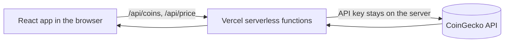

<div align="center">

# CryptoCalc: Price Change Impact Calculator

**See how a crypto price rise or fall changes the value of your holding, in your own currency.**


[**Live Demo**](ADD-YOUR-VERCEL-LINK-HERE) · [Report a Bug](../../issues)

</div>

## Table of Contents

- [Overview](#overview)
- [Features](#features)
- [Tech Stack](#tech-stack)
- [How It Works](#how-it-works)
- [Project Structure](#project-structure)
- [Getting Started](#getting-started)
- [API Reference](#api-reference)
- [Deployment](#deployment)
- [Design Decisions](#design-decisions)
- [Limitations and Future Improvements](#limitations-and-future-improvements)

## Overview

Crypto prices move fast. This app answers one simple question: **"If the price changes by X%, how much will I gain or lose?"**

The user picks a coin, enters how much they hold, chooses a currency and sets a possible price change. The app shows the current value, the new value and the gain or loss right away. A chart also shows the result for many other price changes at once.

## Features

- **Live prices** from the CoinGecko API
- **Top 50 coins** in a searchable dropdown with real coin icons and live prices
- **5 currencies** (INR, USD, EUR, GBP, AED) with country flags
- **Price change input** with a slider, a number box and quick buttons (±5%, ±10%, ±25%)
- **Result cards** for current value, new value and gain or loss
- **Impact chart** showing the gain or loss from -50% to +50%, with your chosen change highlighted
- **Input checks**, loading skeletons and clear error messages with a retry button
- **Responsive** layout for mobile, tablet and desktop
- **Accessible**: labels on inputs, keyboard navigation in dropdowns, visible focus and reduced-motion support

## Tech Stack

| Area | Technology |
|---|---|
| Frontend | React 18 (Vite) |
| Styling | Tailwind CSS v4 |
| Charts | Recharts |
| Icons | Lucide React |
| Backend | Node.js (Vercel serverless functions) |
| Data | CoinGecko API |
| Testing | Vitest |
| Hosting | Vercel |

## How It Works



The calculation lives in `src/utils/calc.js`:

| Step | Formula |
|---|---|
| Current value | `quantity x price` |
| New value | `current value x (1 + change% / 100)` |
| Gain or loss | `new value - current value` |

## Project Structure

```
.
├── api/
│   ├── coins.js          # Top 50 coins with icons and live prices
│   └── price.js          # Live price of one coin
├── public/
│   └── favicon.svg
├── src/
│   ├── components/
│   │   ├── Dropdown.jsx  # Searchable dropdown (coins and currencies)
│   │   ├── HeroArt.jsx   # Hero illustration
│   │   └── motion.jsx    # Scroll reveal and count-up animations
│   ├── utils/
│   │   ├── calc.js       # Calculation logic
│   │   └── calc.test.js  # Unit tests
│   ├── App.jsx           # Main page
│   ├── data.js           # Currency list and built-in coin list
│   ├── useCoins.js       # Loads the live coin list
│   ├── index.css         # Colors, font and animations
│   └── main.jsx          # App entry point
├── .env.example
├── index.html
├── package.json
└── vite.config.js
```

## Getting Started

### Prerequisites

- Node.js 18 or newer
- A free CoinGecko Demo API key from [coingecko.com/en/api](https://www.coingecko.com/en/api)

### Installation

```bash
git clone https://github.com/ketanjethva25/CryptoCalc.git
cd CryptoCalc
npm install
```

### Environment variables

Copy `.env.example` to `.env` and add your key:

```bash
# Windows
copy .env.example .env
# macOS / Linux
cp .env.example .env
```

| Name | Required | Description |
|---|---|---|
| `COINGECKO_API_KEY` | Yes | CoinGecko Demo API key. It is used only on the server and never sent to the browser. |

### Run

```bash
npm run dev      # start the app at http://localhost:5173
npm test         # run unit tests
npm run build    # create a production build
```

## API Reference

Both endpoints are Vercel serverless functions. Errors return `{ "error": "message" }`.

| Endpoint | Query parameters | Success response |
|---|---|---|
| `GET /api/price` | `coin` (for example `bitcoin`), `currency` (for example `inr`) | `{ "price": 7721100 }` |
| `GET /api/coins` | `currency` | `[{ "id", "name", "symbol", "image", "current_price" }, ...]` (top 50 coins) |

Responses are cached for 60 seconds to stay within the API limit.

## Deployment

1. Push the code to GitHub.
2. Import the repository in [Vercel](https://vercel.com).
3. Add the environment variable `COINGECKO_API_KEY`.
4. Click **Deploy**. Vercel builds the frontend and runs the `api` folder as serverless functions.

If you add or change an environment variable later, redeploy so it takes effect.

## Design Decisions

- **Serverless functions instead of calling CoinGecko from the browser.** This keeps the API key private and lets the app cache responses.
- **No database.** The app does not need to save anything, so there is nothing to store.
- **Calculation kept separate from the UI.** The formula is a small pure function, so it is easy to test.
- **Calm design.** One font, a balanced navy and blue palette, soft shadows and gentle animations. No neon colors or heavy effects.

## Limitations and Future Improvements

- Results are estimates based on today's price. This is not financial advice.
- The free CoinGecko plan has rate limits. Caching reduces the problem.
- Ideas for later: save recent calculations in the browser, compare two coins, share a result as a link.

---

Built by **Ketankumar Jethva** as part of the Scalezix internship assessment. Price data by [CoinGecko](https://www.coingecko.com).
